# Product API on AWS ECS (HW5)

A Go server with the two Product endpoints from `api.yaml`. Terraform builds its Docker image, pushes the image to ECR, and runs it on ECS with Fargate. Products are stored in memory. The server exposes Prometheus metrics and writes one JSON log line per request.

## Where things are

| What | Where |
|---|---|
| Server code | `src/product-service.go` |
| Dockerfile | `src/Dockerfile` |
| Go module | `src/go.mod`, `src/go.sum` |
| Infrastructure | `terraform/` |
| Local Prometheus and Grafana stack | `monitoring/` |
| Screenshots | `screenshots/` |

Files in `terraform/`:

| File | Purpose |
|---|---|
| `provider.tf` | AWS and Docker providers, and the ECR login for Docker |
| `variables.tf` | Region, ECR repository name, service name, container port, task count, log retention |
| `main.tf` | Calls the modules, builds the image from `src/`, and pushes it to ECR |
| `outputs.tf` | ECS cluster name and service name |
| `modules/network` | Default VPC subnets and a security group for the container port |
| `modules/ecr` | ECR repository |
| `modules/logging` | CloudWatch log group |
| `modules/ecs` | ECS cluster, Fargate task definition, and service |

Changes from the starter repo: the albums server in `src/` was replaced by the Product server, and `src/Dockerfile` was replaced. In `terraform/`, the image build targets `linux/amd64`, the region is `us-east-1`, and the repository and service names are `hw05-product-api`.

## Deploy the infrastructure

Needs on the machine: Docker (running), Terraform, the AWS CLI, and an AWS Learner Lab session.

### 0. Get the code

```
git clone https://github.com/1AlgoRythm/CS6650_HW05_demo.git
cd CS6650_HW05_demo
```

### 1. Prepare credentials

Copy the temporary credentials from the Learner Lab, then run:

```
aws configure
aws configure set aws_session_token YOUR_SESSION_TOKEN
aws sts get-caller-identity
```

Use region `us-east-1`, the default in `terraform/variables.tf`. The AWS CLI region and the Terraform region must match, because the commands in step 3 look in the CLI region.

### 2. Apply the infrastructure

```
cd terraform
terraform init
terraform apply -auto-approve
```

Terraform builds the image for `linux/amd64`, pushes it to ECR, and starts the ECS service. The task can take a few minutes to start after the apply ends.

On Docker Desktop for Mac, the file `/var/run/docker.sock` may not exist. Then Terraform stops with "Cannot connect to the Docker daemon". Point Terraform at the Docker Desktop socket first, in the same terminal:

```
export DOCKER_HOST=unix://$HOME/.docker/run/docker.sock
```

### 3. Send requests

Run these from the `terraform` folder. First get the public IP address of the running task:

```
aws ec2 describe-network-interfaces \
--network-interface-ids $(
    aws ecs describe-tasks \
    --cluster $(terraform output -raw ecs_cluster_name) \
    --tasks $(
        aws ecs list-tasks \
        --cluster $(terraform output -raw ecs_cluster_name) \
        --service-name $(terraform output -raw ecs_service_name) \
        --query 'taskArns[0]' --output text
    ) \
    --query "tasks[0].attachments[0].details[?name=='networkInterfaceId'].value" \
    --output text
) \
--query 'NetworkInterfaces[0].Association.PublicIp' \
--output text
```

Then call the server. It listens on port 8080:

```
curl http://PUBLIC_IP:8080/products/1
```

The address changes when a task is replaced. Run the command again to get the current one.

### 4. Clean up

```
terraform destroy -auto-approve
```

## Run the server locally

With Go, from `src/`:

```
go run product-service.go
```

With Docker, from `src/`:

```
docker build --platform linux/amd64 -t product-service .
docker run --rm -p 8080:8080 product-service
```

## Endpoints

| Endpoint | Success | Errors |
|---|---|---|
| `GET /products/{productId}` | 200 | 404, 500 |
| `POST /products/{productId}/details` | 204 | 400, 404, 500 |
| `GET /metrics` | 200 | none |

The server starts with three products, ids 1 to 3. `api.yaml` has no endpoint that creates a product. POST edits a product that already exists, and returns 404 for an unknown one. The instructor confirmed this reading on Piazza. Authentication is not implemented. The instructor said it is out of scope.

Choices that `api.yaml` leaves open:

1. A bad product id on GET, such as `abc` or `0`, returns 404. `api.yaml` lists no 400 for GET.
2. A POST body whose `product_id` differs from the path returns 400.
3. The header `X-Simulate-Error: true` triggers 500.
4. The routes have no `/v1` prefix. The `servers` URLs in `api.yaml` are example hosts.

## Examples for every response code

Screenshots of the deployed server, on AWS in `us-east-1`:

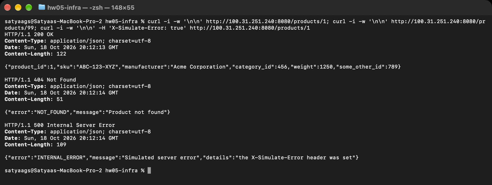

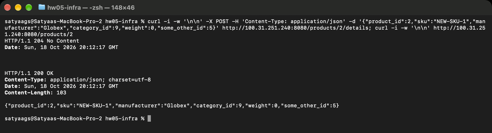

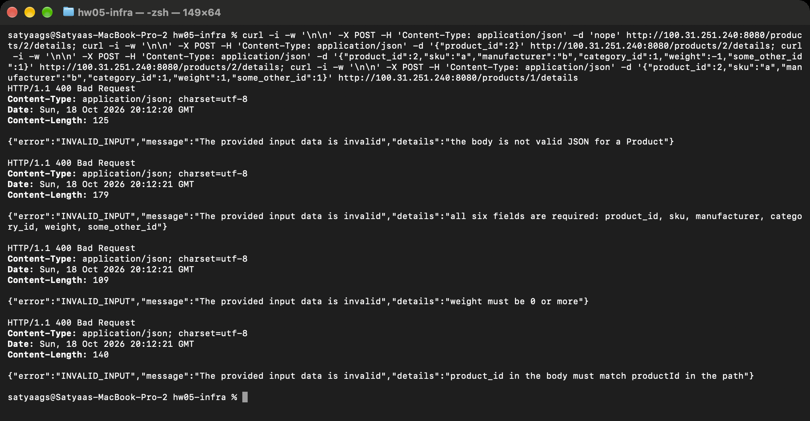

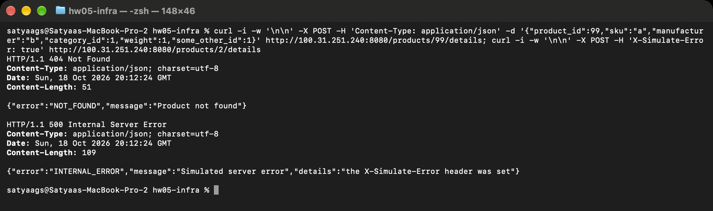

The IP address in the screenshots belongs to the task that was running when they were taken. The same commands, against the server on `localhost:8080`:

```
HOST=http://localhost:8080

# GET 200: product found
curl -i $HOST/products/1

# GET 404: product not found
curl -i $HOST/products/99

# GET 500: the test header triggers it
curl -i -H 'X-Simulate-Error: true' $HOST/products/1

# POST 204: details updated. The next GET shows the change.
curl -i -X POST -H 'Content-Type: application/json' -d '{"product_id":2,"sku":"NEW-SKU-1","manufacturer":"Globex","category_id":9,"weight":0,"some_other_id":5}' $HOST/products/2/details
curl -i $HOST/products/2

# POST 400: the body is not JSON
curl -i -X POST -H 'Content-Type: application/json' -d 'nope' $HOST/products/2/details

# POST 400: a field is missing
curl -i -X POST -H 'Content-Type: application/json' -d '{"product_id":2}' $HOST/products/2/details

# POST 400: a value is outside its limit
curl -i -X POST -H 'Content-Type: application/json' -d '{"product_id":2,"sku":"a","manufacturer":"b","category_id":1,"weight":-1,"some_other_id":1}' $HOST/products/2/details

# POST 400: the body product_id differs from the path
curl -i -X POST -H 'Content-Type: application/json' -d '{"product_id":2,"sku":"a","manufacturer":"b","category_id":1,"weight":1,"some_other_id":1}' $HOST/products/1/details

# POST 404: product not found
curl -i -X POST -H 'Content-Type: application/json' -d '{"product_id":99,"sku":"a","manufacturer":"b","category_id":1,"weight":1,"some_other_id":1}' $HOST/products/99/details

# POST 500: the test header triggers it
curl -i -X POST -H 'X-Simulate-Error: true' $HOST/products/2/details
```

The error replies follow the `Error` schema in `api.yaml`:

```
{"error":"NOT_FOUND","message":"Product not found"}
{"error":"INVALID_INPUT","message":"The provided input data is invalid","details":"weight must be 0 or more"}
{"error":"INTERNAL_ERROR","message":"Simulated server error","details":"the X-Simulate-Error header was set"}
```

## Locust load tests (Part IV)

The tests ran against the deployed server, from a laptop, with Locust 2.46.7 in Docker (one master, 1 to 4 workers). The locustfile has two user classes that differ only in the HTTP client: `ProductUser` uses `HttpUser`, and `ProductFastUser` uses `FastHttpUser`. GET to POST is 3 to 1. Every request is valid, so a healthy server gives zero failures.

### HttpUser against FastHttpUser

Both runs used 1 worker, 50 users, 10 users per second, and 60 seconds.

| Class | Requests | Failures | Median | p95 | Worker CPU, average |
|---|---|---|---|---|---|
| `HttpUser` | 76,972 | 0 | 36 ms | 44 ms | 43% |
| `FastHttpUser` | 79,421 | 0 | 35 ms | 42 ms | 30% |


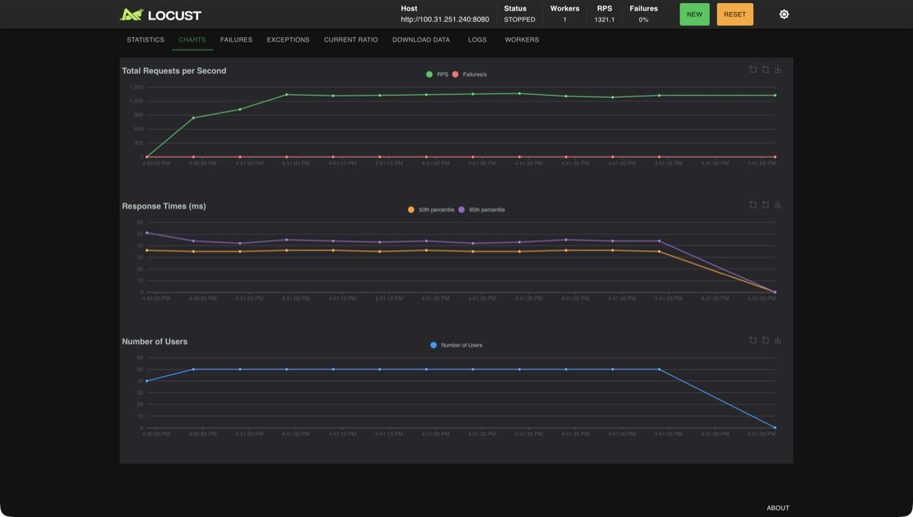

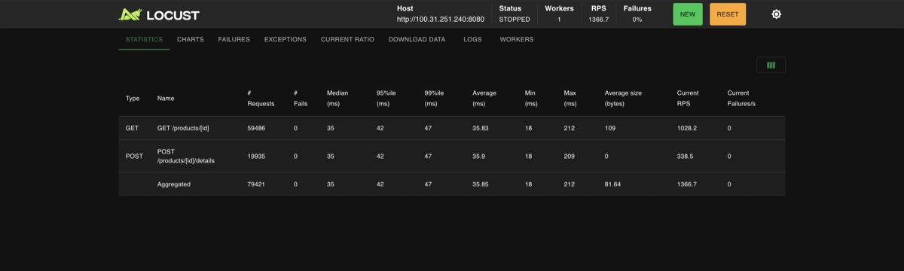

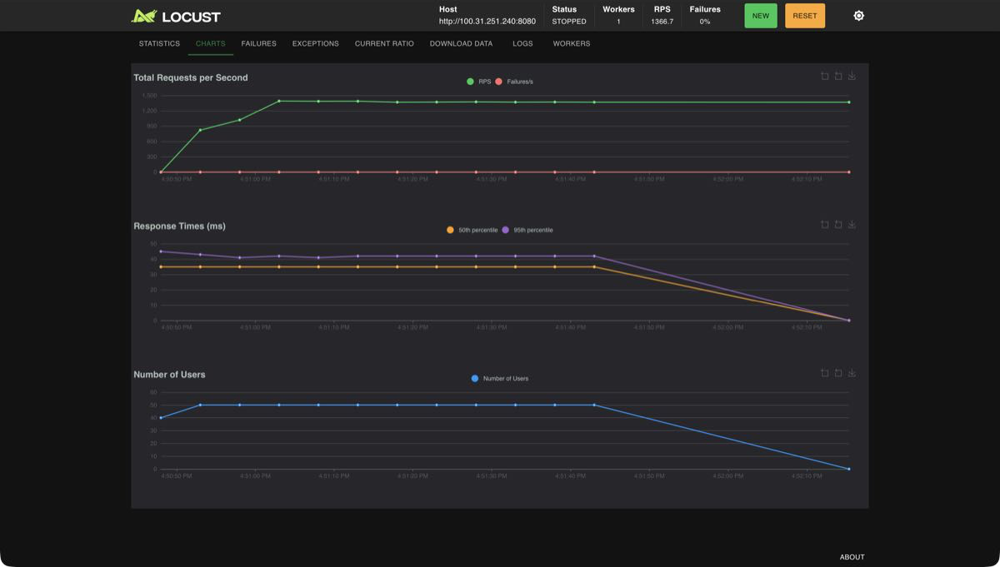

`FastHttpUser` sent 3.2 percent more requests (79,421 against 76,972) and used 13 points less CPU on the worker (30 percent against 43 percent). An earlier pair of runs with the same settings went the same way: 78,761 against 76,218 requests, which is 3.3 percent more, and 28 percent against 38 percent worker CPU. The response times were almost the same. At 50 users, the rate is set by the number of users and the round trip to AWS: 50 users that wait 36 ms for each reply send about 1,400 requests per second with either client. The [Locust documentation](https://docs.locust.io/en/stable/increase-performance.html) says `HttpUser` uses python-requests and `FastHttpUser` uses geventhttpclient, which takes much less CPU on the load generator. It also says `FastHttpUser` does not make a single request faster. The results match both statements. Neither client used a full core, so the large gain that the documentation describes for a saturated client did not show.

### Stress test

The test used `FastHttpUser`, 4 workers, and a step shape: 100, 250, 500, 1,000, 1,500 and 2,000 users, 45 seconds per step, 200 new users per second. About 4.8 percent of the requests (43,182 of 907,615) were refused on purpose, a missing product and a bad body, as real traffic has. Locust counted those as expected.

| Users | Requests per second | Median | p95 | p99 |
|---|---|---|---|---|
| 100 | 2,365 | 38 ms | 64 ms | 86 ms |
| 250 | 3,040 | 45 ms | 107 ms | 160 ms |
| 500 | 3,754 | 84 ms | 197 ms | 288 ms |
| 1,000 | 3,732 | 98 ms | 315 ms | 498 ms |
| 1,500 | 3,685 | 110 ms | 491 ms | 701 ms |
| 2,000 | 3,602 | 196 ms | 617 ms | 897 ms |

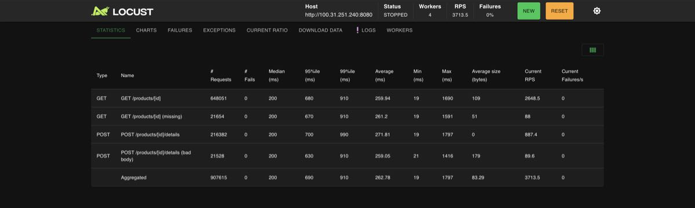

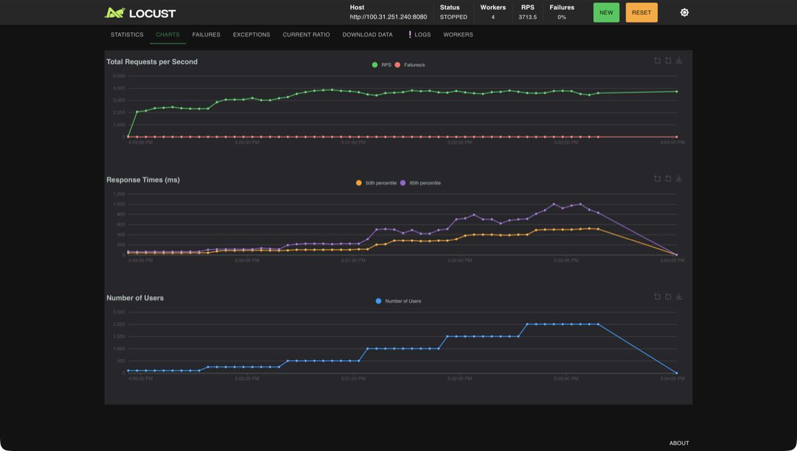

The test sent 907,615 requests, with 0 failures in Locust, and no 500 replies. The rate stopped growing at about 3,750 requests per second, from 500 users on. After that, more users only made the responses slower. The ECS task, with a quarter of a vCPU, averaged 96 to 100 percent CPU in each full minute from 16:59 to 17:02 EDT. The first and last minutes were partial: 1.4 percent and 35.8 percent on average. The 100-user step had a median of 38 ms, close to the 36 ms of the 50-user runs, so the task was probably not saturated at that step. ECS reports CPU in one-minute buckets, and they do not line up exactly with the 45-second steps. The data does not show the exact moment when the task became saturated. The four Locust workers used about 15 percent of a core each, so the load generator was not the limit.

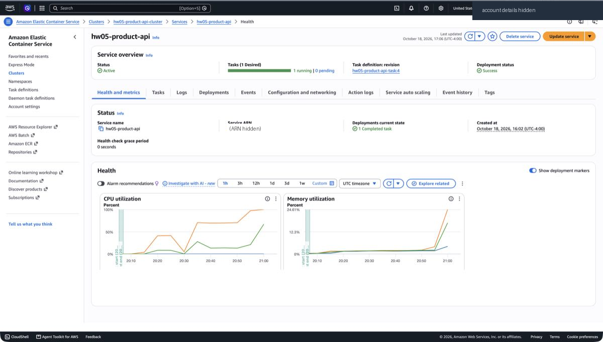

The time axis is UTC. Each point covers 5 minutes. The orange line is the maximum, and the green line is the average. The green point for 17:00 to 17:05 EDT is about 67 percent, because it averages the busy minutes with the idle minute that follows.

## Observability (Part V)

### Metrics with Prometheus and Grafana

`GET /metrics` serves three metrics, each with the labels `method` and `endpoint`: `http_requests_total` for rate, `http_request_errors_total` for errors (every non-2xx reply), and `http_request_duration_seconds` for duration, as a histogram. The label `endpoint` is the route template, such as `/products/:productId`, so product ids do not create new labels.

The stack runs on the local machine and is not deployed to AWS. It holds the app, Prometheus, and Grafana with a provisioned dashboard, "Product API: RED signals". From `monitoring/`:

```
docker compose up -d --build
```

| Service | Address |
|---|---|
| Local app | `http://localhost:8080` |
| Prometheus | `http://localhost:9090` |
| Grafana | `http://localhost:3000` |

Grafana opens without a login, because the stack is meant for local use only. Prometheus scrapes two targets, listed in `monitoring/prometheus/targets.json`: the local app, labelled `where="local"`, and the deployed task, labelled `where="aws"`. The dashboard has a `target` dropdown to pick one. To watch the deployed task, put its public IP address in `targets.json`. Prometheus rereads the file by itself. To stop the stack, run `docker compose down`.

The dashboard has panels for rate, errors and duration (p50 and p95), a panel of responses by status code, and three "now" numbers. The screenshot is from the stress test above. It starts with 2 minutes of quiet, then the load, then quiet again.

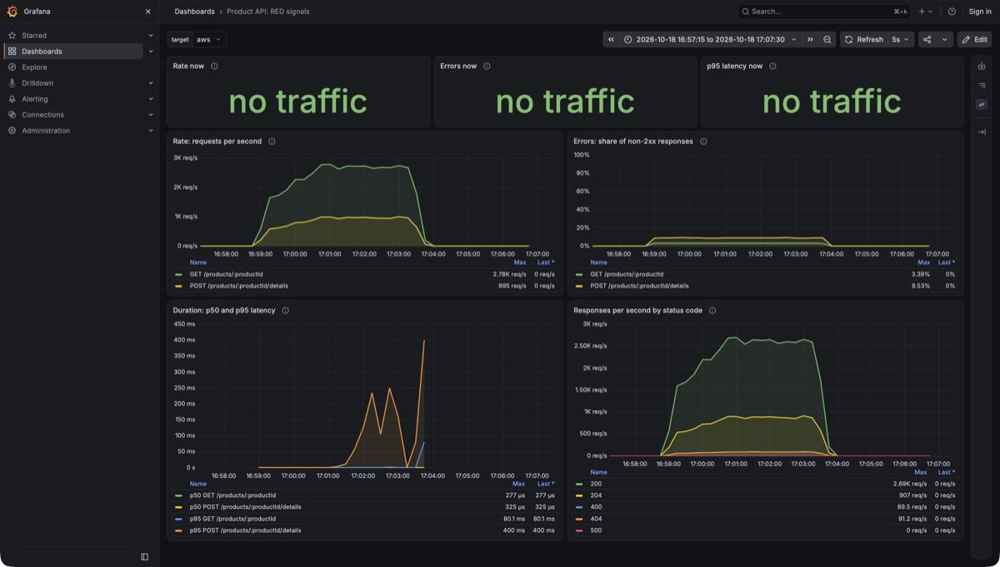

At the peak the rate was about 2,780 reads and 995 writes per second. The errors were 3.4 percent for GET and 9.5 percent for POST, which are the requests refused on purpose. The median handler time stayed at about 0.3 ms. The 95th percentile of POST handler time rose to 400 ms in the last steps.

### The same signals in logs

The server writes one JSON line per request to standard output. On AWS, CloudWatch Logs holds them in the log group `/ecs/hw05-product-api`. This excerpt is from the stress test, at 17:02:40 EDT, in the 2,000-user step. The time field is in UTC. The last two lines are one 404 and one 400 from the same moment.

```
{"time":"2026-10-18T21:02:39.999999479Z","level":"INFO","msg":"request","method":"POST","endpoint":"/products/:productId/details","path":"/products/2/details","status":204,"duration_ms":0.013}
{"time":"2026-10-18T21:02:40.000079567Z","level":"INFO","msg":"request","method":"GET","endpoint":"/products/:productId","path":"/products/1","status":200,"duration_ms":0.006}
{"time":"2026-10-18T21:02:40.000210745Z","level":"INFO","msg":"request","method":"GET","endpoint":"/products/:productId","path":"/products/3","status":200,"duration_ms":0.012}
{"time":"2026-10-18T21:02:40.000306111Z","level":"INFO","msg":"request","method":"POST","endpoint":"/products/:productId/details","path":"/products/2/details","status":204,"duration_ms":0.014}
{"time":"2026-10-18T21:02:40.000383774Z","level":"INFO","msg":"request","method":"GET","endpoint":"/products/:productId","path":"/products/1","status":200,"duration_ms":0.012}
{"time":"2026-10-18T21:02:40.000431723Z","level":"INFO","msg":"request","method":"POST","endpoint":"/products/:productId/details","path":"/products/1/details","status":204,"duration_ms":0.04}
{"time":"2026-10-18T21:02:39.913629782Z","level":"INFO","msg":"request","method":"GET","endpoint":"/products/:productId","path":"/products/99","status":404,"duration_ms":0.002}
{"time":"2026-10-18T21:02:40.001367517Z","level":"INFO","msg":"request","method":"POST","endpoint":"/products/:productId/details","path":"/products/2/details","status":400,"duration_ms":0.016}
```

Over the whole stress test, the server's own counter and CloudWatch Logs both counted 909,615 requests, and Locust counted 907,615. The difference is 2,000, which equals the number of users when the test stopped. This fits one request in flight per user at the stop, which Locust does not count. That reading is an inference and was not confirmed.

### Dashboard or logs

Look at the dashboard while the system runs. It shows a change in rate, errors or latency as it happens, and it compares now with a quiet period. Look at the logs after the fact, when nobody watched the dashboard. They show which request failed, with its path, its status and its time.
